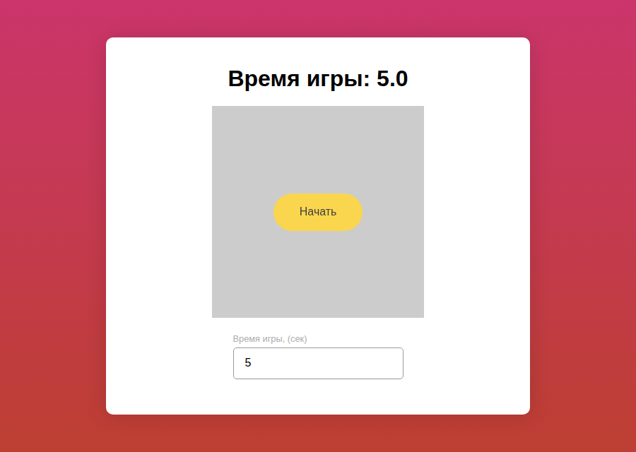
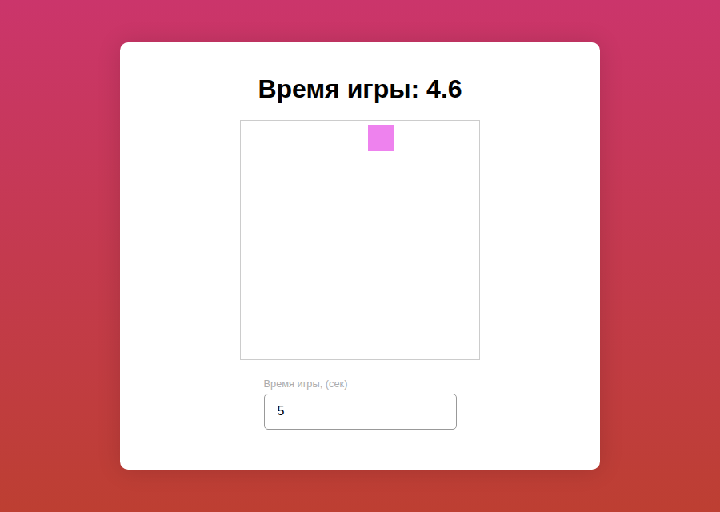
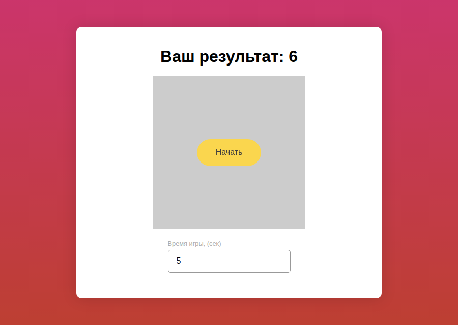
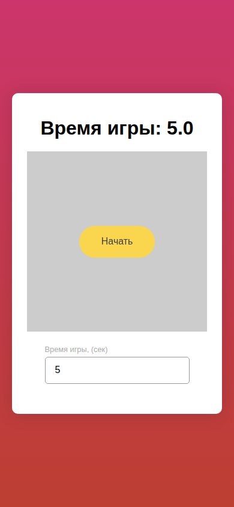

# Click the Box — a JavaScript game

A small browser game in vanilla JavaScript, written in one afternoon on 15 June 2019: click as many
coloured boxes as you can before the time runs out. Every click moves the box to a random place and
gives it a random size and colour. The interface is in Russian.

<table>
  <tr>
    <th>Start</th>
    <th>Playing</th>
    <th>Result</th>
    <th>Phone</th>
  </tr>
  <tr>
    <td valign="top"></td>
    <td valign="top"></td>
    <td valign="top"></td>
    <td valign="top"></td>
  </tr>
</table>

## How to play

1. Set the game time in seconds (5 by default) and press **Начать** (Start).
2. Click the box — each hit is a point, and a new box appears somewhere else.
3. When the timer reaches zero, the score is shown.

## Run it

Open `app/index.html` in a browser. No build, no dependencies.

## How it works

- `startGame()` starts a 100 ms `setInterval` countdown and draws the first box.
- `renderBox()` creates a `div` with a random size (30–100 px), colour and position inside the field.
- Clicks are handled once on the field (event delegation) and counted only on `data-box` elements.
- `endGame()` stops the timer, clears the field and shows the score.

## Structure

```
app/
├── index.html
├── index.js
└── styles.css
```

Made by [Ilya Bielov](https://www.facebook.com/MrBiela).
